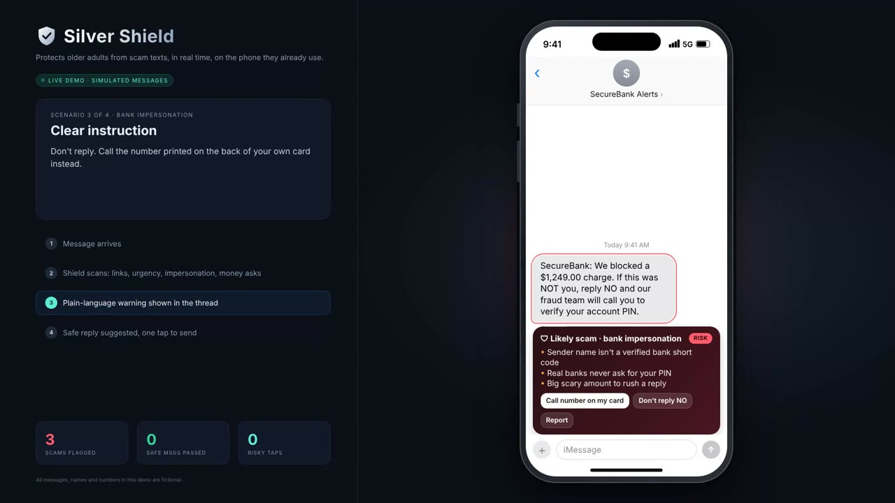

# Silver Shield: "Is this text a scam?"

Team project for Track 5 (Personal Safety), challenge A. Paste a text or email; get **Likely scam / Cannot tell / No red flags found**, the specific warning signs in plain language, and what to do next. Works in English, Spanish and Chinese. Runs entirely in the browser: no API key, nothing sent anywhere.

## See it in action (60-second demo)

[](demo/silver-shield-demo.mp4)

**▶ [Watch the 60-second video](demo/silver-shield-demo.mp4)**

An iPhone gets four simulated texts (a fake package delivery, a "grandchild in trouble" gift-card request, a fake bank fraud alert, and a real message from family). For each one, Silver Shield shows the warning signs in plain words and suggests a safe next step. It stays quiet on the real message. All names, numbers and messages are fictional. The animated slide the video was recorded from is [`demo/index.html`](demo/index.html): open it in a browser and go full-screen (Space = pause, R = restart).

## Try it

- **Live demo:** https://claude.ai/artifact/8xtWeXGbUr7FwrQVEX7Atx (private: the repo owner can share it)
- **One file, no setup:** download [`silver-shield.html`](silver-shield.html) and open it in any browser. It works offline.
- **Public website:** once GitHub Pages is on (Settings → Pages → Deploy from branch → `main`, `/ (root)`), the checker is at https://ssethi408.github.io/silver-shield/

## Run it

```bash
npm run fetch      # download the labeled datasets into data/ (not committed)
npm run eval       # train the word model, score it, write results/metrics.md
npm run serve      # then open http://localhost:8000
npm run check -- "Your package is on hold, pay the fee at bit.ly/xyz"
```

Opening `index.html` directly in a browser also works. Node 18+ and Python 3 are the only requirements.

## How it works

| File | What it does |
|---|---|
| `checker/engine.js` | Red-flag rules (money transfer, codes/passwords, urgency, prizes, toll/package, family emergency, job/crypto, impersonation, disguised links) with explanations in 3 languages, plus the three-way verdict |
| `checker/model.js` | Naive Bayes word model trained on 70% of the UCI SMS set (generated by `npm run eval`, English only) |
| `index.html` | The one-screen checker |
| `silver-shield.html` | The same page as a single file (rebuilt by `npm run eval`) |
| `checker/cli.js` | Command-line checker |
| `eval/train_and_eval.js` | Train/test split, metrics on UCI held-out, phishing-multi sample and current-style messages |
| `eval/current_scams.json` | 22 current-style test messages (13 scam, 9 benign) in EN/ES/ZH written by the team |
| `results/metrics.md` | Latest measured results, including what it gets wrong |

## Results (see `results/metrics.md`)

**Three questions, not one accuracy score:** Did the checker flag a labeled suspicious text? Did it miss one? Did it wrongly flag a labeled normal text? Only **Likely scam** counts as a catch; **Cannot tell** is a miss when the text is labeled suspicious.

| Test set | Suspicious texts caught | Suspicious texts not caught | Normal texts wrongly flagged |
|---|---:|---:|---:|
| 2012-era UCI SMS (1,672 held out; “spam” is not confirmed fraud) | 200/224 (89.3%) | 24/224 (10.7%) | 5/1,448 (0.3%) |
| Other-source short texts, including email (600 sampled) | 113/300 (37.7%) | 187/300 (62.3%) | 106/300 (35.3%) |
| Team-written recent-style examples (22, EN/ES/ZH) | 10/13 (76.9%) | 3/13 (23.1%) | 0/9 (too few to estimate a rate) |

The second test deliberately includes 300 suspicious and 300 normal short texts; it is **not** an SMS-only sample or the natural frequency of suspicious messages. UCI's label is *spam*, not verified fraud. The team-written examples are a small smoke test, not independent validation. Never interpret “No red flags” as safe.

## Plotly evaluation dashboard

Open [`dashboard/index.html`](dashboard/index.html) directly: a single-file, offline Plotly dashboard with interactive charts **and the actual checker**, which updates the verdict and explanations immediately as you type or paste a message. It shows scam catch rates, missed scams, false alarms, a rules-vs-model ablation, tiny EN/ES/ZH examples, limitations, and the verification steps a reader should take. Nothing is sent to a server. It is a local artifact, not a live data feed.

To refresh it from the same source code and the labeled data:

```bash
npm run fetch
npm run eval
mkdir -p dashboard/vendor
curl -fsSL https://cdn.plot.ly/plotly-2.35.2.min.js -o dashboard/vendor/plotly-2.35.2.min.js
python3 dashboard/build_dashboard.py
```

The build verifies the vendor bundle's SHA-256 before embedding it; its pinned digest is in `dashboard/build_dashboard.py`. The generated dashboard has no remote dependencies. The full raw datasets are ignored by git. Review [`results/metrics.md`](results/metrics.md) for examples of mistakes, and [`results/metrics.json`](results/metrics.json) for the measured counts driving the charts. On 600 short texts from an *unseen source* (including some email), the checker catches only 113/300 phishing/spam and falsely flags 106/300 benign messages. Do **not** pitch the 89.3% old-SMS catch rate as real-world scam protection. The 22 modern-style examples were written by the team, not collected blindly.

## Working together

- Pull before you push: `git pull --rebase`, then `git push`.
- Change the rules in `checker/engine.js`, then run `npm run eval` and commit the new `results/metrics.md` with your change so everyone sees the effect.
- Add new test messages to `eval/current_scams.json`. Never commit real people's messages, phone numbers or API keys.
- One person owns `SUBMISSION.md` to avoid conflicts at the deadline.

---

# Event brief: Claude Impact Lab SF: Trust & Safety Micro-Hack

Five worries about AI in San Francisco, public data for each, and one evening to build something that keeps people safe.

A Claude Community event, hosted by Claude Ambassadors with Antler. Tuesday, Nov 17, 2026, Antler SF.

## Agenda

| Time | What happens |
|---|---|
| 6:00 | Doors open |
| 6:30 | Welcome |
| 6:50 | Conversation corners |
| 7:15 | Share-backs panel |
| 7:30 | Build with mentors |
| 8:45 | Demos and finalists |

## Tracks

Pick one file. Each has the concern, build ideas sized for an hour, the datasets, the traps in the data, and a demo checklist.

1. [Agents in Inboxes](01-agents-in-inboxes.md): an agent reads my email. What stops a stranger's email from giving it orders?
2. [Spot the Rogue Agent](02-spot-the-rogue-agent.md): one agent in a team goes rogue. Can the others find it and shut it out?
3. [Robotaxis & Robots](03-robotaxis-and-robots.md): how safe are robotaxis here, and what is nobody reporting?
4. [Privacy](04-privacy.md): what surveillance tech covers my city, and where does my data go?
5. [Personal Safety](05-personal-safety.md): AI made scams and fakes cheap. How do my parents tell what is real?
0. [Room challenge](00-room-challenge.md): a concern from the room that fits none of the above.

## Datasets

- [datasets.md](datasets.md): every dataset as a table, with links, licenses and caveats.
- [datasets.json](datasets.json): the same catalog, machine-readable.

## Hand in

Pencils down at 8:30. Push your repo with [SUBMISSION.md](SUBMISSION.md) filled in, hand your team card to a judge, and be ready to demo in 3 minutes: the concern, the thing working on real data, one honest limitation. Judges pick six finalists from the cards.

## Repo map

```
README.md                   this file: agenda, tracks, how to hand in
00-room-challenge.md        wildcard track: a concern from the room
01-agents-in-inboxes.md     track 1
02-spot-the-rogue-agent.md  track 2
03-robotaxis-and-robots.md  track 3
04-privacy.md               track 4
05-personal-safety.md       track 5
datasets.md                 every dataset as a table: links, licenses, caveats
datasets.json               the same catalog, machine-readable
SUBMISSION.md               team card, six answers, judging rubric
```

## If you are a coding agent

Read the track file your team picked and [datasets.md](datasets.md). Build the smallest thing that runs on real data: one page, one notebook or one CLI. Pull small samples first. Never collect API keys or personal data. State one limitation.
